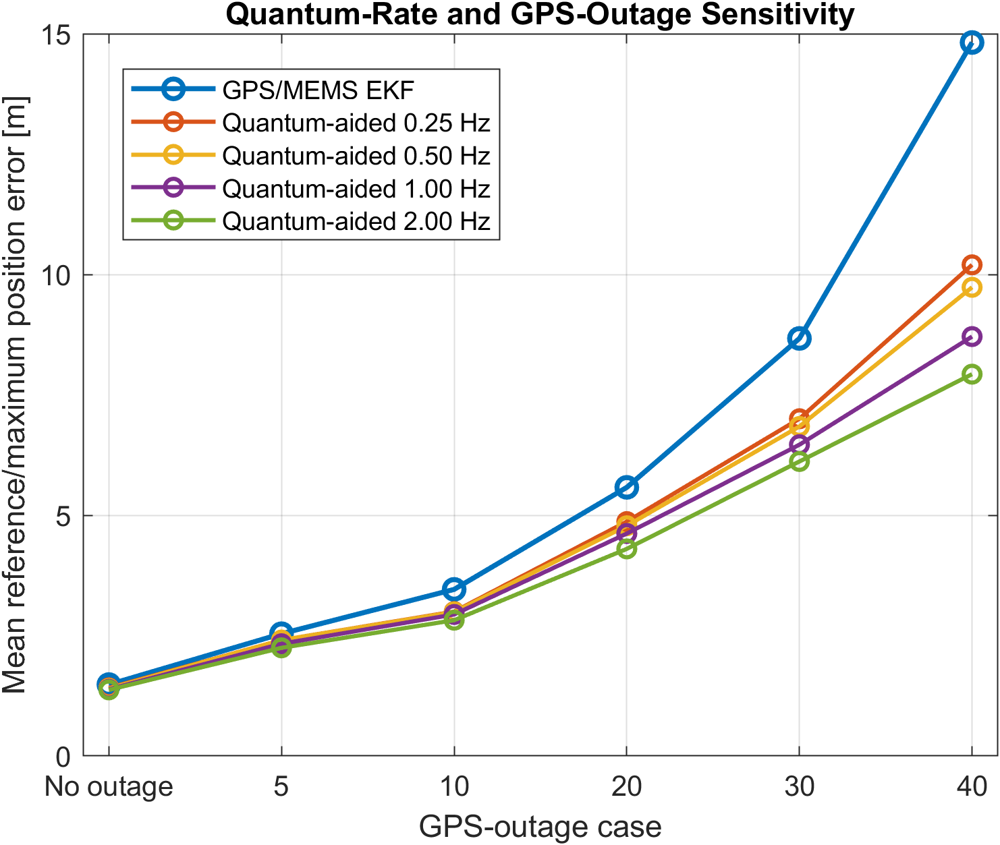
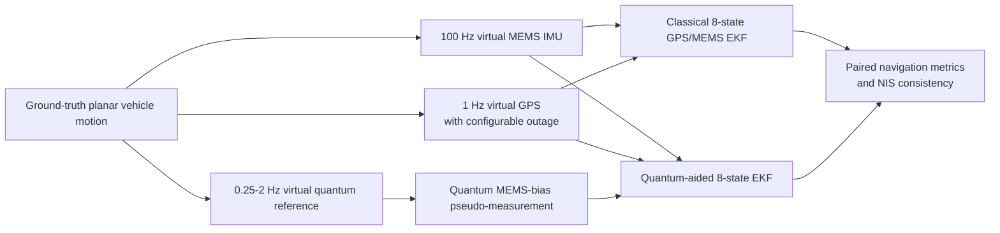
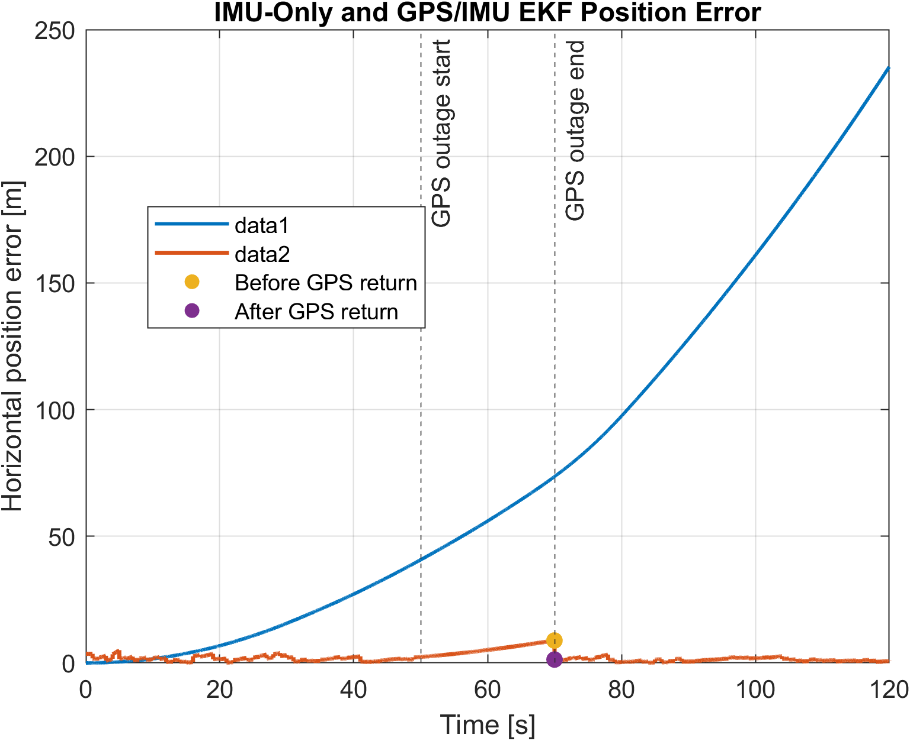
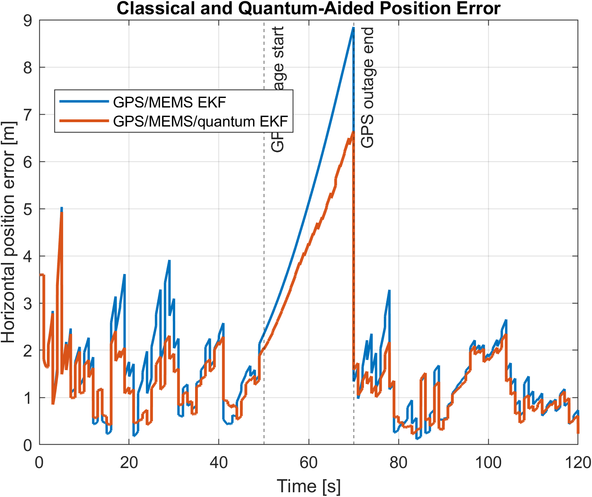
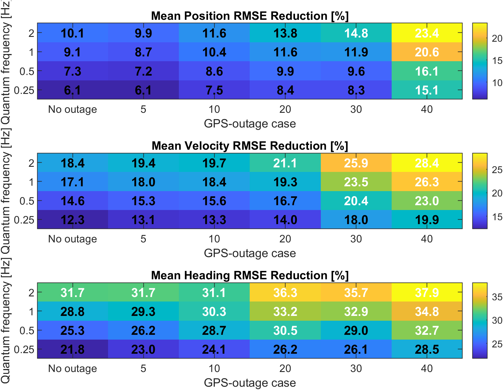
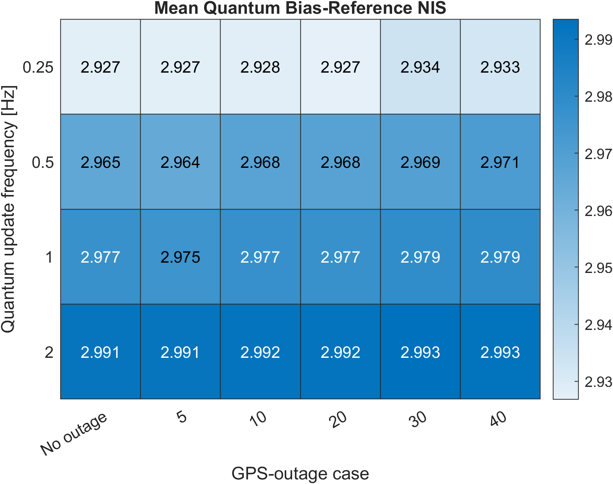

<div align="center">

# OpenNavLab

### Classical and Quantum-Aided Resilient Navigation in MATLAB

**GPS/IMU EKF · MEMS bias estimation · cold-atom reference abstraction · Monte Carlo validation**

</div>

> [!IMPORTANT]
> OpenNavLab is a **software-only navigation research prototype**. The quantum sensor is a navigation-level abstraction of a low-rate cold-atom inertial reference. It is not a hardware-validated atom-optics model and does not yet model fringe ambiguity, vibration rejection, dead time, laser phase noise, axis misalignment or laboratory integration effects.

## Overview

OpenNavLab studies how low-rate quantum inertial measurements can improve a classical MEMS/GPS navigation system during GPS outages. The project builds the complete workflow in MATLAB: deterministic vehicle motion, synthetic MEMS and GPS sensors, inertial dead reckoning, an eight-state Extended Kalman Filter, a virtual cold-atom reference, paired Monte Carlo validation and outage/update-rate sensitivity studies.

The latest Phase 7D experiment contains **100 paired Monte Carlo runs**, six GPS-outage cases and four quantum update rates, for a total of **3,000 filter simulations**.

## Key result

During a **40-second GPS outage**, increasing the quantum bias-reference rate progressively reduced the ensemble mean maximum position error:

| Filter | Mean maximum error | Reduction in ensemble mean | P95 error | Runs improved |
|---|---:|---:|---:|---:|
| GPS/MEMS EKF | 14.818 m | — | 27.200 m | — |
| Quantum-aided 0.25 Hz | 10.200 m | 31.2% | 18.604 m | 62% |
| Quantum-aided 0.50 Hz | 9.734 m | 34.3% | 16.855 m | 67% |
| Quantum-aided 1.00 Hz | 8.710 m | 41.2% | 16.087 m | 75% |
| Quantum-aided 2.00 Hz | **7.929 m** | **46.5%** | **13.725 m** | **78%** |

For the 2 Hz case, the mean paired absolute improvement was **6.889 m**, with an approximate 95% confidence interval of **[5.228, 8.549] m**. The classical GPS NIS was 1.9416 against an expected value of 2, while the quantum-reference NIS was 2.9666 against an expected value of 3.

> The **46.5%** figure is the reduction between the two ensemble means. The CSV also contains a mean of per-run relative reductions; those are different statistical quantities and should not be used interchangeably.



## System architecture



## Navigation state

The filters estimate

```math
\mathbf{x} =
\begin{bmatrix}
 p_x & p_y & v_x & v_y & \psi & b_{a_x} & b_{a_y} & b_g
\end{bmatrix}^T.
```

The MEMS IMU drives high-rate nonlinear propagation. GPS supplies a two-dimensional position correction when available. The quantum branch forms a low-rate direct observation of MEMS accelerometer and gyroscope biases.

## Research phases

| Phase | Purpose | Main script |
|---|---|---|
| 1 | Ground-truth vehicle trajectory | `examples/run_truth_trajectory.m` |
| 2 | Virtual MEMS IMU with white noise and bias random walk | `examples/run_virtual_imu.m` |
| 3 | IMU-only dead reckoning and drift analysis | `examples/run_dead_reckoning_analysis.m` |
| 4 | Virtual 1 Hz GPS with a configurable outage | `examples/run_virtual_gps.m` |
| 5 | Eight-state GPS/IMU EKF | `examples/run_gps_imu_ekf.m` |
| 6A | Classical EKF Monte Carlo validation | `examples/run_monte_carlo_validation.m` |
| 6B | GPS-outage-duration sensitivity | `examples/run_outage_duration_sensitivity.m` |
| 7A | Virtual low-rate cold-atom reference | `examples/run_virtual_quantum_sensor.m` |
| 7B | Single-run quantum-aided navigation comparison | `examples/run_quantum_aided_navigation.m` |
| 7C | Paired classical/quantum Monte Carlo comparison | `examples/run_quantum_aided_monte_carlo.m` |
| 7D | Quantum-rate and GPS-outage sensitivity | `examples/run_quantum_sensitivity_study.m` |

## Quick start

### Requirements

- MATLAB R2025a recommended; the latest reported studies were run in R2025a.
- A modern MATLAB release supporting `tiledlayout`, `heatmap`, `boxchart` and `exportgraphics`.
- No physical IMU, GPS receiver or quantum hardware is required.
- Core numerical code uses base MATLAB operations; the project implements its own percentile calculation to avoid a Statistics Toolbox dependency.

### Run a phase

```matlab
cd OpenNavLab
startup
run('examples/run_truth_trajectory.m')
run('examples/run_virtual_imu.m')
run('examples/run_gps_imu_ekf.m')
```

Run the final sensitivity study with:

```matlab
run('examples/run_quantum_sensitivity_study.m')
```

On the reference Windows machine, the 100-run Phase 7D study required about **20 minutes**. Start with Phases 1-5 before launching the larger Monte Carlo studies.

## Selected validation results

### Classical GPS/IMU EKF

The complete virtual IMU accumulated 235.27 m of final dead-reckoning position error. GPS/IMU fusion reduced the final position error to 0.605 m and the position RMSE to 2.766 m. During the 20-second GPS outage, the maximum error was 8.849 m and fell to 1.337 m at the first returning GPS update.



### Quantum-aided single-run comparison

At 1 Hz, quantum bias-reference updates reduced the single-run maximum outage error from 8.849 m to 6.640 m and reduced position, velocity and heading RMSE.



### Monte Carlo sensitivity






## Interactive research dashboard

OpenNavLab also includes a MATLAB dashboard for inspecting the saved experiments
without moving estimator mathematics into the UI layer.

The dashboard provides:

- animated truth / classical / quantum-aided trajectory replay;
- synchronized position, velocity and heading-error views;
- MEMS-bias and innovation-consistency inspection;
- project-evolution comparison across the classical and quantum-aided phases;
- Phase 7C paired Monte Carlo exploration;
- Phase 7D outage-duration / quantum-rate sensitivity analysis;
- a built-in regression self-test and reproducible evidence export.

The default dashboard views are backed by the saved OpenNavLab results. The
Mission page contains a separately labelled **Preview** mode for interactive
what-if visualization; preview cases are not presented as rerun EKF results.

Run it with:

```matlab
cd dashboard
app = run_opennavlab_dashboard;
```

For a GitHub-ready visual set, run:

```matlab
files = export_dashboard_screenshots(app);
```

This writes six live UI captures under
[`docs/dashboard/screenshots/`](docs/dashboard/screenshots/). See the [dashboard documentation](docs/dashboard/README.md), including the [User guide](docs/dashboard/USER_GUIDE.md), [Architecture](docs/dashboard/ARCHITECTURE.md), [Validation](docs/dashboard/VALIDATION.md), and [Reproducibility](docs/dashboard/REPRODUCIBILITY.md).

## Repository structure

```text
OpenNavLab/
├── config/       Sensor, filter and study configurations
├── examples/     Reproducible phase-level MATLAB scripts
├── src/          Trajectory, sensor, navigation, filter and analysis code
├── results/
│   ├── data/     CSV summaries and paired-run data
│   └── figures/  Generated validation figures
├── dashboard/    Interactive replay, statistics, validation and evidence UI
├── docs/
│   ├── dashboard/  Dashboard usage and screenshot workflow
│   └── ...         Mathematical model, methodology and limitations
├── startup.m     Adds project folders to the MATLAB path
└── README.md
```

Large generated `.mat` files are intentionally excluded from this GitHub-ready package. They are regenerated by the example scripts and are ignored by `.gitignore`.

## Documentation

- [Methodology and phase map](docs/methodology.md)
- [Mathematical model](docs/mathematical_model.md)
- [EKF formulation](docs/ekf_formulation.md)
- [Quantum sensor abstraction](docs/quantum_sensor_model.md)
- [Validation results](docs/validation_results.md)
- [Limitations and future work](docs/limitations_and_future_work.md)
- [Repository audit](docs/repository_audit.md)
- [Reproducibility and runtime](docs/reproducibility.md)
- [Application-ready project summary](docs/application_summary.md)
- [Interactive dashboard](docs/dashboard/README.md)

## Reproducibility

All sensors and Monte Carlo cases use explicit random seeds. Phase 7C and Phase 7D use paired simulations so that the classical and quantum-aided filters receive the same initialization, MEMS realization and GPS measurements for each comparison.

## Citation

Citation metadata is available in [`CITATION.cff`](CITATION.cff).

## License

Released under the [MIT License](LICENSE).
